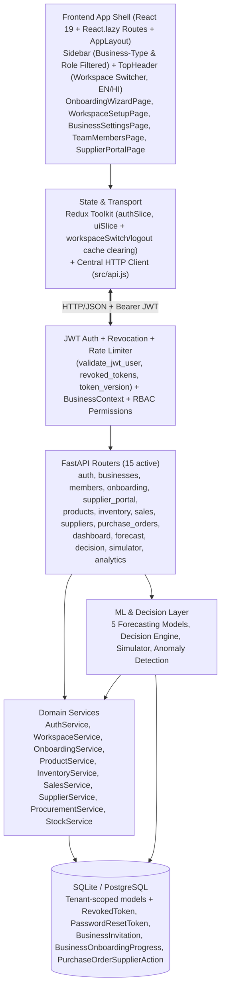

# SYSTEM ARCHITECTURE SPECIFICATION
## Smart Inventory Management System (SIMS / StockSangati)
**Updated:** 2026-11-27 (Phase 5 Multi-Tenant Auth, Workspaces & Onboarding)  
**Architecture Style:** Tenant-Isolated Layered FastAPI + SQLAlchemy Backend with Modular React 19 + Redux Toolkit SaaS Frontend

---

## 1. Full-Stack Layered Architecture

---

## 2. Phase 5 Security & Workspace Modules

- **`app/core/security.py` & `rate_limiter.py`**: Argon2id password hashing, access + refresh JWTs with `jti`/`type`/`token_version`, SHA-256 reset token hashing, and sliding-window HTTP `429` rate limiting.
- **`app/core/permissions.py` & `app/dependencies/authorization.py`**: Declarative `ROLE_PERMISSIONS` (`owner`, `admin`, `manager`, `analyst`, `staff`, `supplier`), `require_permission`, `require_business_types`, and `get_business_context`.
- **`app/services/workspace_service.py` & `onboarding.py`**: Multi-business creation/switching, email-bound invitations, role hierarchy enforcement, and 10-step persisted onboarding.
- **Cross-Reference Guides**: [AUTHENTICATION_AND_AUTHORIZATION.md](file:///d:/sims/AUTHENTICATION_AND_AUTHORIZATION.md), [MULTI_TENANT_ARCHITECTURE.md](file:///d:/sims/MULTI_TENANT_ARCHITECTURE.md), [ONBOARDING_FLOW.md](file:///d:/sims/ONBOARDING_FLOW.md), [INTERNATIONALIZATION.md](file:///d:/sims/INTERNATIONALIZATION.md).
