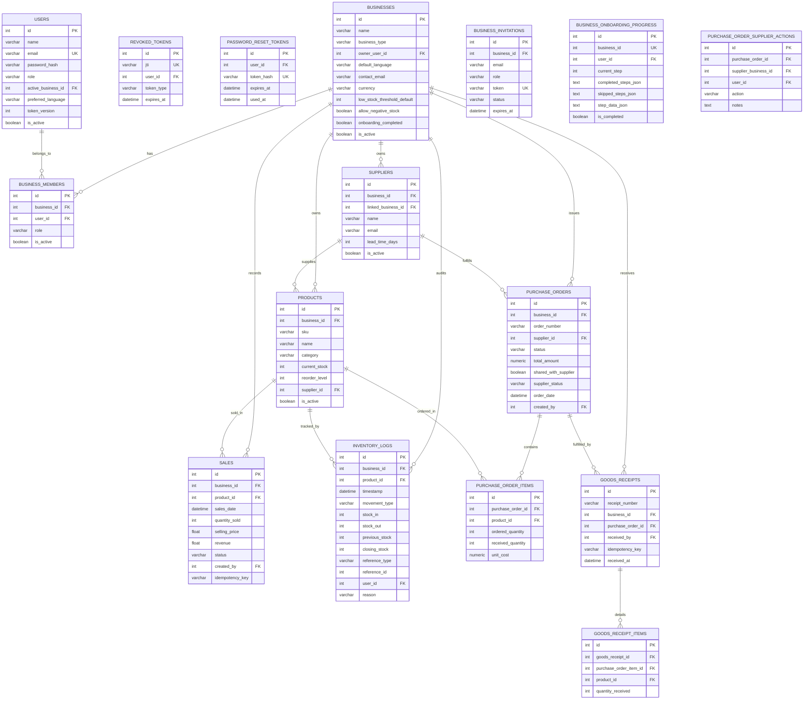

# SIMS DATABASE DESIGN & SCHEMA SPECIFICATION
## Smart Inventory Management System (SIMS / StockSangati)
**Updated:** 2026-11-27 (Post-Phase 5 Auth, Workspaces & Onboarding)  
**Active Engine:** SQLite (`backend/inventory.db`) via SQLAlchemy 2.1.3 with `PRAGMA foreign_keys=ON` and `PRAGMA busy_timeout=5000` (PostgreSQL dialect normalization configured in `backend/app/database.py`).  
**Safe Upgrade Module:** `backend/app/db_migrate.py` (`ensure_schema_and_backfill`) creates new tables, runs idempotent `ALTER TABLE ADD COLUMN` upgrades, creates indexes, and backfills tenant ownership without dropping or overwriting existing records.

---

## 1. Entity-Relationship Diagram

---

## 2. Key Schema & Integrity Enforcements

1. **Tenant Isolation Columns & Unique Scopes:**
   - `businesses` and `business_members` (`UNIQUE(business_id, user_id)`).
   - `business_id` FK and index on `suppliers`, `products`, `sales`, `inventory_logs`, `purchase_orders`, `goods_receipts`.
   - `UNIQUE(business_id, sku)` on `products`; `UNIQUE(business_id, name)` on `suppliers`; `UNIQUE(business_id, order_number)` on `purchase_orders`.
2. **Idempotency Constraints:**
   - `UNIQUE(business_id, idempotency_key)` on `sales` and `goods_receipts`.
3. **Check Constraints (enforced on newly created tables & validated in services):**
   - `products`: `current_stock >= 0`, `cost_price >= 0`, `selling_price >= 0`, `reorder_level >= 0`.
   - `sales`: `quantity_sold > 0`, `selling_price >= 0`, `revenue >= 0`.
   - `purchase_order_items`: `ordered_quantity > 0`, `0 <= received_quantity <= ordered_quantity`, `unit_cost >= 0`.
   - `goods_receipt_items`: `quantity_received > 0`.
4. **Traceable Ledger (`inventory_logs`):**
   - Stores `business_id`, `product_id`, `movement_type` (`OPENING_STOCK`, `PURCHASE_RECEIPT`, `SALE`, `STOCK_ADJUSTMENT`, `RETURN`, `REVERSAL`), `stock_in`, `stock_out`, `previous_stock`, `closing_stock`, `reference_type`, `reference_id`, `user_id`, `reason`, `timestamp`.
5. **Performance Indexes:**
   - Composite indexes `(business_id, product_id, sales_date)` on `sales`, `(business_id, product_id, timestamp)` on `inventory_logs`, `(business_id, status)` on `purchase_orders`, and `(purchase_order_id, product_id)` on `purchase_order_items`.
6. **Known Remaining Limitation:**
   - Stock reservations are not yet implemented (`reserved_stock` is explicitly `0` in inventory position responses).
